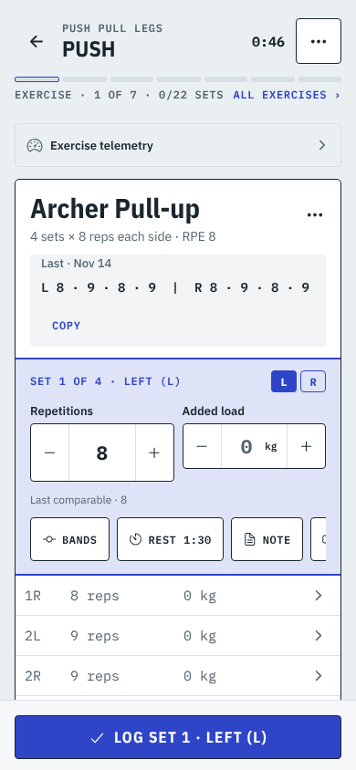
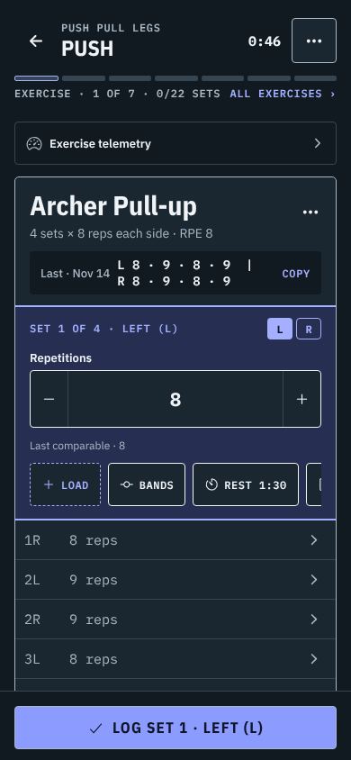
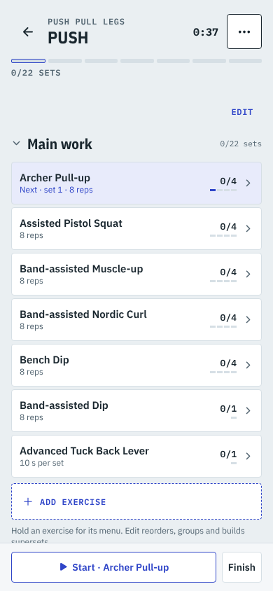
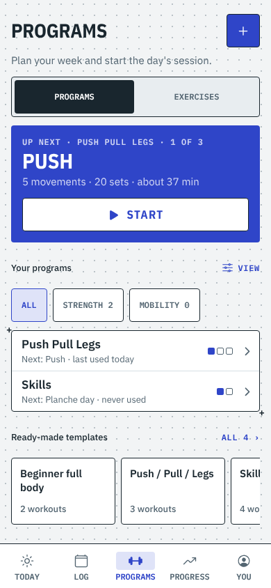

# TrackItBetter

**Offline-first calisthenics & bodyweight training tracker** for Android, iOS, and web preview.

Built for bodyweight skills—holds, progression chains, resistance bands, and apparatus—rather than adapting a barbell-first log. Everything lives locally on your device in SQLite with full JSON backup, restore, and portable imports. No account, no cloud lock-in, no subscriptions.

[](https://github.com/massone99/TrackItBetter/releases/latest)


<p align="center">
  
  
  
  
</p>

## Download

Prebuilt Android APKs (`arm64-v8a`) are published automatically on [GitHub Releases](https://github.com/massone99/TrackItBetter/releases). Download the latest `.apk` and install it directly on your device.

## What it does

### Fast gym logging
- **Bodyweight-native metrics:** log reps, timed holds, distance, added load, unilateral left/right pairs, resistance band sets (with tension levels and kg assistance), and apparatus (bar, rings, parallettes, floor) with apparatus-aware history comparisons.
- **Built for one-handed use:** big primary action per screen, rest and hold timers, supersets, warm-up / main / mobility blocks, swipe gestures, EMOM, timed hold protocols, and narrated audio/beep mode.
- **Quality & context:** track RPE, form cleanliness (1–5), range of motion (1–5), notes, and attach short form-check video clips directly to a set.

### Skill progressions & chains
- **Custom progression ladders & graphs:** build ordered progression chains and exercise links (progression, prerequisite, variation) with automatic cycle detection.
- **Quality-gated targets:** set rep or hold criteria over consecutive sessions—optionally gated by minimum form rating and maximum RPE so you advance on clean reps.
- **Contextual next-step cues:** subtle, foldable suggestions from your previous session (repetition addition, linear bumps, lighter band assistance, consolidation, or hybrid-set bridging when ready to level up).

### Programs & mesocycles
- **Flexible structure:** flat rotations, weekly/phase groups, pick-one alternatives, drag-to-reorder, bulk editing, and quick-add syntax (`pull-ups 4x5 +10kg @8 r180`, `plank 3x30s`).
- **Week & mesocycle generator:** generate multi-week blocks with linear progression, double progression, set addition, Light / Heavy, DUP, and automatic deload weeks.
- **Structural balance:** live horizontal and vertical push–pull set balance right inside the program and workout builders.

### Progress, estimator & body tracking
- **Analytics & records:** personal bests separated by load, bands, apparatus, and side; trend charts with RPE-based max projections; weekly push/pull balance, stimulus zone split (strength / hypertrophy / endurance), and mesocycle & fatigue tracking.
- **Max & hold estimator:** estimate max reps, max hold, and 1RM from any single set with RPE, added load, or bands—plus adaptation zones and isometric hold prescriptions (Prilepin 60–75% and 60-second method).
- **Mobility, pose & body log:** guided mobility routines and tests, on-device pose angle analysis (MoveNet Thunder TFLite), bodyweight, measurements, progress photos, daily/weekly goals, reminders, and an offline **Training Principles** guide.

### Local & portable data
- **Full JSON backup & restore** on device—your training history never leaves your phone unless you export it.
- **Shareable JSON imports** for programs, exercises, progression chains, and mobility routines—see [docs/IMPORT_JSON.md](docs/IMPORT_JSON.md) and the schema in [docs/trackitbetter-import.schema.json](docs/trackitbetter-import.schema.json).

---

## Design & accessibility

- **"Chalk, steel, birch" visual system:** flat surfaces with hairline ink rules, light and dark themes, gym-mat blue actions, birch highlights for records, and tabular scoreboard numerals (`IBM Plex Sans Condensed` / `Barlow`).
- **Scales cleanly:** supports 70%–130% interface scaling and up to 200% system text size without clipping or cramped touch targets (48 dp minimum across every screen).
- **Bilingual UI:** English and Italian, verified by automated translation parity tests.

---

## Tech stack

- **App:** Expo SDK 57, React Native, Expo Router, React Compiler, TypeScript
- **Data:** `expo-sqlite` + Drizzle ORM (fully offline)
- **Motion & graphics:** React Native Reanimated, Gesture Handler, Skia
- **On-device ML:** `react-native-fast-tflite` (MoveNet Thunder for pose analysis)

---

## Running locally

### Requirements
- Node.js 22.13+
- npm
- Expo Go (JS shell) or an EAS / local development build for native modules

### Start
```sh
npm install        # also applies patches/ via patch-package
npm start          # press a (Android), i (iOS), or w (web)
```

First launch initializes `trackitbetter.db` and seeds the bundled exercise and progression catalog.

### Web preview
The web build runs SQLite in a worker and requires cross-origin isolation. `metro.config.js` sets `Cross-Origin-Opener-Policy` and `Cross-Origin-Embedder-Policy` automatically for the dev server; any static host serving `npx expo export -p web` must send the same headers.

---

## Building an Android APK

Requires JDK 17 and the Android SDK (`ANDROID_HOME` set). The `android/` directory is generated on demand and not committed:

```sh
npm run build:apk
# -> build/TrackItBetter-<version>.apk
```

`scripts/build-apk.sh` runs prebuild and compiles for `arm64-v8a` with compressed native libraries to keep the APK small. For other ABIs (such as an `x86_64` emulator), run `ABIS=x86_64 npm run build:apk`.

> Note: local release builds are signed with the debug keystore for convenient sideloading. Use an upload key or `eas build -p android` for store distribution.

### Releasing
```sh
npm run version:bump -- patch   # or minor, major, or x.y.z
```
Updates `app.json` (version, Android `versionCode`, iOS `buildNumber`), `package.json`, and `package-lock.json`. Add a matching `## <version> - YYYY-MM-DD` section to [CHANGELOG.md](CHANGELOG.md); pushing the `app.json` change to `main` triggers the Android release workflow and publishes `v<version>`.

---

## Quality checks

```sh
npm run typecheck          # TypeScript strict check
npm run lint               # ESLint + React Compiler rules
npm test -- --ci           # Unit, DB integration, i18n, and accessibility tests
npm run ui:audit           # Headless layout audit of every screen at 70%, 100%, and 200% text
npx expo-doctor
```

Automated guards included in `npm test` and `npm run ui:audit`:
- **Accessibility & UI standards** (`src/shared/components/__tests__/uiStandards.test.ts`): checks every screen for `accessibilityRole`, translated labels, `Sheet` confirmations, and interactive `ListRow` rules.
- **Translation parity** (`src/shared/i18n/__tests__/resources.test.ts`): guarantees English and Italian stay in sync, every `t(...)` key exists, and counted strings define singular/plural forms.
- **Headless layout audit** (`tools/ui-audit/`): renders every route in `app/` against an in-memory SQLite database at three scale profiles and flags clipping, overlaps, off-screen elements, and sub-48 dp touch targets.

---

## Project docs

- [CHANGELOG.md](CHANGELOG.md) — release history
- [docs/IMPORT_JSON.md](docs/IMPORT_JSON.md) — portable JSON format for programs, chains, exercises, and mobility routines
- [docs/LANGUAGE.md](docs/LANGUAGE.md) — domain vocabulary (en/it)
